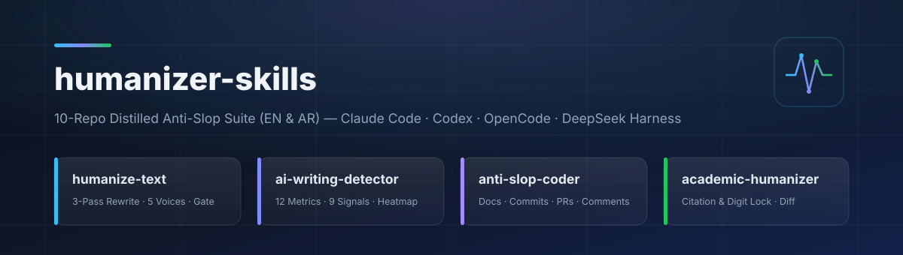

<div align="center">



<br/>

**حزمة ثنائية اللغة (العربية + الإنجليزية) لأنسنة النصوص ومكافحة بصمات الذكاء الاصطناعي (`AI Slop`) — تضم ٥ مهارات قياسية ([Agent Skills](https://agentskills.io)) وأمر التوجيه `/humanize` و٤ أدوات فحص إحصائي صفرية الاعتماديات، مستخلصة من ١٠ مستودعات مفتوحة المصدر ومتوافقة مع `OpenCode` و`Claude Code` و`Codex CLI` و`DeepSeek Harness`.**

[](https://github.com/abduallahJamal/humanizer-skills/actions/workflows/validate.yml)
[](#المهارات-الخمس-في-الحزمة)
[-818CF8)](#أدوات-سطر-الأوامر-الإحصائية-المدمجة)
[](#دعم-العربية-والإنجليزية-من-الجذور)
[](#التثبيت-السريع)
[](#التثبيت-السريع)
[](#التثبيت-السريع)
[](#التثبيت-السريع)
[](LICENSE)

**[🇬🇧 English](README.md)** · **🇪🇬 العربية**

</div>

---

<div align="right" dir="rtl">

## 📌 لماذا حزمة مقسّمة حسب المهمة بدلاً من برومبت واحد ضخم؟

دمج كل قواعد الأنسنة في برومبت واحد يخلق تعارضاً حتمياً: فإدخال الاختصارات العامية والجمل المبتورة لإضفاء «عفوية بشرية» يفسد الأوراق البحثية والتقارير الرسمية، بينما إضافة روابط مثل `Moreover,` و«علاوة على ذلك» آلياً ترفع نسبة الاشتباه في الكواشف الحديثة، وتمرير قواعد النثر على مستودعات الكود قد يتلف مربعات الأكواد أو يترك التعليقات السردية بلا تنظيف.

لهذا تفصل حزمة `humanizer-skills` المهام في **٥ مهارات متخصصة غير متضاربة** مدعومة **بسكربتات Python قياسية محلية** تتولى العدّ الدقيق وحساب التنوع الإيقاعي (`Burstiness`) والتحقق من عدم ضياع أي رقم أو مرجع.

## 🧩 المهارات الخمس في الحزمة

| المهارة | الدور الأساسي | الأداة البرمجية المرفقة | خلاصة المستودعات المدمجة |
| :--- | :--- | :--- | :--- |
| **[`humanize`](skills/humanize/SKILL.md)** | موجّه ذكي (`/humanize`) يصنّف الطلب ويوجهه تلقائياً للمهارة الأنسب | يوجّه للمهارات الأربع | توجيه بالكشف التدريجي (`Progressive Disclosure`) |
| **[`humanize-text`](skills/humanize-text/SKILL.md)** | إعادة كتابة على ٣ مراحل + ٩ رافعات إحصائية + ٥ شخصيات صوتية مع منع اختلاق الحقائق | `humanize_gate.py` | `blader/humanizer`, `lguz`, `harshaneel/humanize`, `haidrrrry`, `ZAYUVALYA`, `ADEMOLA200` |
| **[`ai-writing-detector`](skills/ai-writing-detector/SKILL.md)** | **وضع الكشف الجنائي فقط** بدون تعديل النص: ١٢ مقياساً إحصائياً + ٩ إشارات (`0–27`) وخريطة حرارية للجمل | `detect_ai_metrics.py` | `conorbronsdon/avoid-ai-writing`, `harshaneel` (`ai-check`), `rudra496/StealthHumanizer` |
| **[`anti-slop-coder`](skills/anti-slop-coder/SKILL.md)** | تنظيف وحماية `README.md` والتوثيق وأوصاف `PR` ورسائل `git commit` والتعليقات البرمجية | `repo_slop_scan.py` | `ofershap/ai-humanizer`, `blader` (§19–§26), `avoid-ai-writing` (`edit`) |
| **[`academic-humanizer`](skills/academic-humanizer/SKILL.md)** | أنسنة الأبحاث والرسائل الأكاديمية والتقارير الرسمية مع قفل المراجع والمعادلات والأرقام وتقرير `Diff` | `academic_prep.py` | `DadaNanjesha`, `StealthHumanizer` (`academic-inversion`), `ZAYUVALYA` |

---

## 🚀 التثبيت السريع

لا تحتاج الحزمة إلى أي مكتبات خارجية (`bash` + مكتبة `Python 3.9+` القياسية فقط).

</div>

```bash
git clone https://github.com/abduallahJamal/humanizer-skills.git
cd humanizer-skills

# تثبيت عام على الجهاز لجميع المنصات الأربع دفعة واحدة
./install.sh --all --global

# أو التثبيت داخل مشروع محدد فقط
./install.sh --all --project /path/to/your-project

# أو التثبيت لمنصة بعينها
./install.sh --dsh --global
./install.sh --claude --global
./install.sh --codex --global
./install.sh --opencode --global
```

<div align="right" dir="rtl">

**على نظام Windows (PowerShell):**

</div>

```powershell
.\install.ps1 --target all --scope global
```

---

<div align="right" dir="rtl">

## 🛠️ مصفوفة التوافق مع المنصات الأربع

| المنصة | مسار المشروع | المسار العام للمستخدم | طريقة الاستدعاء | التوافق الهندسي المدمج |
| :--- | :--- | :--- | :--- | :--- |
| **OpenCode** | `.opencode/skills/` | `~/.config/opencode/skills/` | `/humanize` أو تلقائياً | ترويسة `YAML` محاطة بعلامات اقتباس + أمر `.opencode/commands/humanize.md` |
| **Claude Code** | `.claude/skills/` | `~/.claude/skills/` | `/humanize-text`, `/ai-writing-detector` | ملفات `.claude-plugin/plugin.json` و`marketplace.json` |
| **Codex CLI** | `.agents/skills/` و`.codex/skills/` | `~/.agents/skills/` و`~/.codex/skills/` | `$humanize`, `$humanize-text` | ملفات `agents/openai.yaml` لكل مهارة + `.agents/plugins/marketplace.json` |
| **DeepSeek Harness** | `.dsh/skills/` (الأولوية 100) | `~/.dsh/skills/` (`$DSH_HOME/skills`) | `skill({ name })` / لوحة الأوامر | **تخطيط مسطّح من مستوى واحد** متوافق مع فاحص `@deepseek-ai/dsh-skill-filesystem` |

---

## 🌍 دعم العربية والإنجليزية من الجذور

إلى جانب القواميس الإنجليزية الكاملة، تتضمن الحزمة دليلاً مخصصاً لكشف وإصلاح بصمات الذكاء الاصطناعي في الكتابة العربية ([`ar-patterns.md`](skills/humanize-text/references/ar-patterns.md)):

- **إصلاح الركاكة المترجمة (`Translation Calques`):** التخلص من الإفراط في صيغة «تم + المصدر»، وحشو «يقوم بـ + المصدر»، وتكرار «بشكل + صفة»، والتوازي السلبي المترجم حرفياً «لا يقتصر الأمر على X فحسب، بل يتعداه إلى Y».
- **حذف المقدمات والخواتيم المعلّبة:** إزالة عبارات «في ظل التطورات المتسارعة»، «مما لا شك فيه»، «يلعب دوراً محورياً»، وتكدس «علاوة على ذلك / بالإضافة إلى ذلك» في مطالع الفقرات.
- **حماية النصوص الثابتة والأرقام:** حماية الآيات والأحاديث والمصطلحات القانونية والتقنية وأسماء الأعلام والأرقام (سواء كُتبت بـ `0-9` أو `٠-٩`).

---

## 🧪 أدوات سطر الأوامر الإحصائية المدمجة

يمكن تشغيل جميع السكربتات مباشرة من الطرفية أو استدعاؤها تلقائياً عبر الوكيل:

</div>

```bash
# 1. فحص نص عربي أو إنجليزي بـ 12 مقياساً إحصائياً واستخراج أخطر الجمل
python3 skills/ai-writing-detector/scripts/detect_ai_metrics.py --file draft.txt

# 2. التحقق الصارم من النص المؤنسَن وسلامة الأرقام والمصطلحات
python3 skills/humanize-text/scripts/humanize_gate.py --original raw.txt --rewritten clean.txt

# 3. فحص ملفات التوثيق والتعليقات البرمجية ورسائل الـ Commit
python3 skills/anti-slop-coder/scripts/repo_slop_scan.py README.md src/

# 4. تجهيز الأبحاث الأكاديمية والتحقق من بقاء المراجع والمعادلات 100% مع توليد ملف Diff
python3 skills/academic-humanizer/scripts/academic_prep.py prep -i paper.txt -o prepped.txt
python3 skills/academic-humanizer/scripts/academic_prep.py verify -o paper.txt -r final.txt -d diff.md
```

---

<div align="right" dir="rtl">

## 📂 هيكل المستودع

</div>

```text
humanizer-skills/
├── assets/banner.svg                  # شعار المستودع
├── skills/                            # المصدر الأساسي للمهارات الخمس (تخطيط مسطّح)
│   ├── humanize/                      # مهارة التوجيه الذكي (/humanize)
│   ├── humanize-text/                 # أنسنة النصوص (EN/AR) + بوابة humanize_gate.py
│   ├── ai-writing-detector/           # الفحص الجنائي والإحصائي + detect_ai_metrics.py
│   ├── anti-slop-coder/               # نظافة التوثيق والكود والـ Git + repo_slop_scan.py
│   └── academic-humanizer/            # الأنسنة الأكاديمية وقفل المراجع + academic_prep.py
├── .opencode/                         # نسخة مطابقة لـ OpenCode + أمر /humanize
├── .claude/ & .claude-plugin/         # نسخة مطابقة لـ Claude Code + بيانات الإضافة
├── .agents/                           # نسخة مطابقة لـ Codex CLI + بيان السوق
├── .dsh/                              # نسخة مطابقة لـ DeepSeek Harness
├── scripts/
│   ├── sync-platforms.sh              # مزامنة وفحص تطابق SHA-256 بين المنصات الأربع
│   └── validate.py                    # فاحص الترويسات والروابط والاختبارات الوظيفية
├── install.sh / install.ps1 / install.py
├── README.md                          # التوثيق بالإنجليزية
└── README.ar.md                       # التوثيق بالعربية (RTL)
```

<div align="right" dir="rtl">

---

## 📄 الترخيص

مرخّص بموجب رخصة [MIT](LICENSE) — جميع الحقوق محفوظة © 2026 Abduallah Jamal.

</div>
